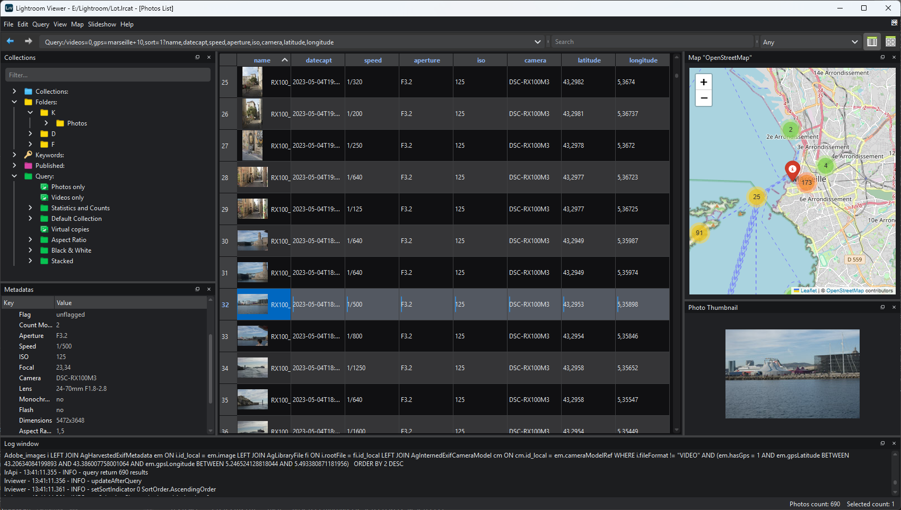
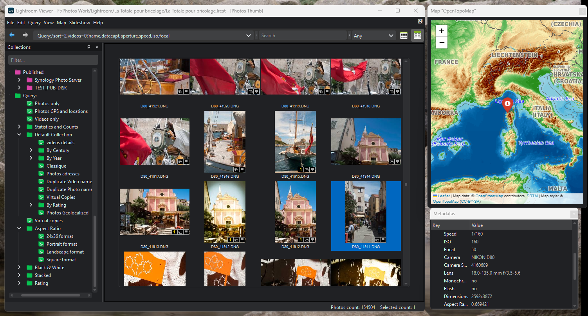

# LrViewer
LrViewer is a Lightroom viewer without Lightroom.

## Overview

LrViewer is a python application, displaying photos and metadatas from Lightroom catalog :

* Lightroom catalogs (*.lrcat) opened in readonly, accessed with my library [Lightroom-SQL-tools](https://github.com/fdenivac/Lightroom-SQL-tools)
* Display Lightroom collections : standard collections, smart collections (not fully supported), folders, keywords, published collections
* Allow specific queries using [Lightroom-SQL-tools syntax](https://github.com/fdenivac/Lightroom-SQL-tools#using-lrselect-script)
* The images displayed come from Lightroom cache (in "`<CATALOG> Previews.lrdata`" folder).
* Optionnaly, lrviewer can build thumbnails (lrpev files) from original photos or from developed photos in directory

<br>

<div style="display: flex; justify-content: center; gap: 5%; align-items: flex-start;">
  
  
</div>

<br>

## New features in this version
* build previews from various source via plugin
* display indicators in thumbnail view (rating, has collection, keyword, gps)
* improve slideshow
* logs filter on console and log window
* metadatas window support multiple photos

<br>

## Installation
```
pip install -U git+https://github.com/fdenivac/lrviewer
```
lrviewer application is installed in "Scripts" folder of python.


## Usage
Lrviewer is a GUI application, with optionnal command line :

```
> lrviewer --help
usage: appLrView.py [-h] [--query-url QUERY_URL] [-b LRCAT] [-S] [-t TIMER] [-D {dark,light,qdark,none}] [-V] [--log-modules LOG_MODULES]
                    [--log-level LOG_LEVEL]

View Photos from Lightroom catalog

options:
  -h, --help            show this help message and exit
  --query-url QUERY_URL
                        Initial Query URL (the address bar syntax: <COLLECTIONTYPE>:/<CRITERIA>?<COLUMNS>)
  -b, --lrcat LRCAT     Ligthroom catalog file for database request (default:"D:/Photos/Lightroom/My Catalog.lrcat")
  -S, --slideshow       Start slideshow in fullscreen
  -t, --timer TIMER     Seconds between slide (used with --slideshow option)
  -D, --dark-theme {dark,light,qdark,none}
                        Theme to use
  -V, --version         Show version and exit
  --log-modules LOG_MODULES
                        Specify the modules logged (comma-separated list). Can be comboHist,appLrPhotosList,photosThumbView,dlgColumns,lrprev,delegateText,delegateThumb,modelPhotos,thumbProvider,modelCollections,photosListView,metadatasView,mapWidget,metadatas,slideshow.slideshow,treeViewCollections,appLrCollTree,dlgCriteria,lrApi,rootpixels,collectionsWidget
  --log-level LOG_LEVEL
                        Set the logging level (DEBUG, INFO, WARNING, ERROR, CRITICAL)
```

### Launch Application
* When installed via pip, lrviewer is located in python Scripts directory, accessible from python environment.
```
> lrviewer
```

* From project cloned, execute something as:
```
cd <DIR>/LrViewer/scr/lrviewer
python appLrView.py
```

<br>

## About Previews (Thumbnails)

Lightroom is a **categorization and non-destructive editing software**. Non-destructive because the edits made in the development module are not written to the disk, but rather stored in the catalog as **instructions**. These edits will be applied when exporting images, but **never on the original photos**.

However, these modifications are immediately applied to **preview files** (`.lrprev` files containing multiple thumbnails of the photo in various sizes).

**LrViewer**, however, **does not know** — and **most likely will never know** — how to apply the modifications made in the development module. It can only build **previews** based on the **original photos** or **photos exported from Lightroom**.

### Strategy for Preview Generation in lrviewer

When opening a **new catalog**, the application will ask for the strategy to follow for building the previews:

- **Do not build previews**:
  - LrViewer will only use the previews generated by Lightroom.
  - **Drawback**: Some photos may not have any available preview.

- **Build previews from original photos**:
  - **Drawback**: The generated previews will not match the edits made in Lightroom.

- **Build previews from Lightroom-exported photos**:
  - **This is my default workflow**: My catalogs are exported using the **"Meta Export" export module** (https://github.com/clammet/MetaExport) into a directory organized by date.


The chosen strategy for a specific catalog is **saved in the settings**, and will be applied the **next time the catalog is opened**.

<br>

## Build standalone executable with Nuitka
* install python Nuitka module
* execute :
```
cd <PROJECT>/src/lrviewer
python -m nuitka \
    --standalone --onefile \
    --enable-plugin=pyside6 \
    --include-package=plugins \
    --windows-icon-from-ico=ico/lrviewer48x48.png \
    --include-data-dir=slideshow/=slideshow/ \
    --include-data-dir=ico/=ico/ \
    --output-dir=../../build/nuitka \
    --output-filename=lrviewer \
    appLrView.py
```
